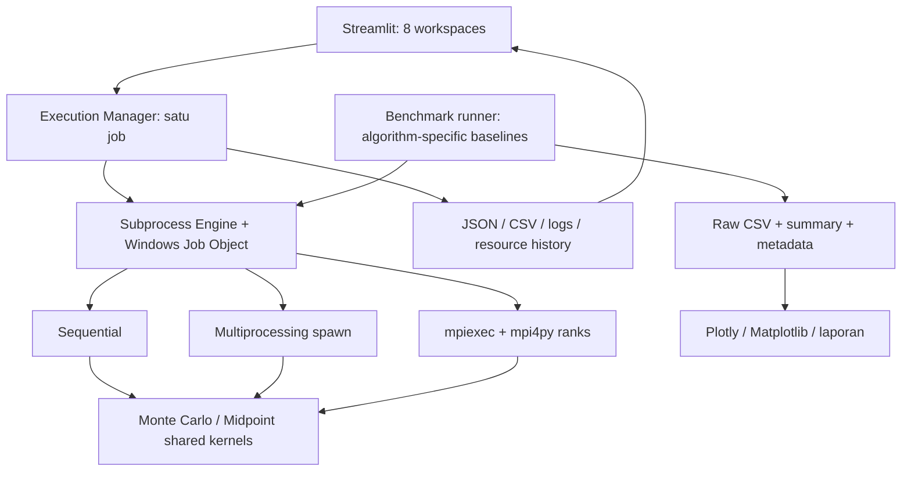

# Proposal Penelitian

## Judul dan konteks

**Comparative Performance Analysis of Python Multiprocessing and MPI-Based Parallel Computing Using Monte Carlo and Numerical Integration Algorithms**

Aplikasi **HPC Parallel Computing & Performance Lab** mendukung mata kuliah **Scalable Parallel Program**, dengan kaitan pada parallel computing optimization, resource monitoring, dan scientific visualization.

## Latar belakang

Pembagian perhitungan ke beberapa proses tidak selalu mempercepat aplikasi. Process startup, Python imports, serialization, IPC, collective communication, serta granularitas tugas dapat mendominasi workload kecil. Perbandingan yang dapat dipertanggungjawabkan memerlukan algoritma yang sama lintas execution model dan batas timing yang konsisten.

Monte Carlo dan Midpoint dipilih karena keduanya mengestimasi π dengan unit kerja independen, tetapi memiliki karakter numerik berbeda. Monte Carlo bersifat stokastik dan mereduksi integer counts; Midpoint bersifat deterministik dan mereduksi float64 partial sums. Kedua algoritma dijalankan dengan sequential, multiprocessing, dan MPI untuk memisahkan efek algoritma dari efek model paralel.

## Rumusan masalah dan research questions

1. Bagaimana E2E time berubah antara sequential, multiprocessing, dan MPI pada algoritma yang sama?
2. Bagaimana p memengaruhi strong scaling, speedup, dan parallel efficiency?
3. Bagaimana workload memengaruhi amortisasi startup dan coordination overhead?
4. Bagaimana CPU/RSS yang terukur berbeda antarmetode?
5. Bagaimana numerical accuracy Monte Carlo dan Midpoint berbeda tanpa mencampurkannya dengan parallel speedup?

## Tujuan

Menghasilkan enam konfigurasi komputasi nyata yang benar, kerangka benchmark dengan baseline per algoritma, visualisasi interaktif yang jujur terhadap data, job management yang aman di Windows, dan dokumentasi reproduksi. Dashboard menjadi sarana eksperimen dan presentasi, sementara kernel/CLI tetap dapat dijalankan secara independen.

## Manfaat

Mahasiswa dapat mempelajari domain decomposition, reproducible pseudorandom streams, spawn-safe multiprocessing, MPI reductions, numerical summation, serta perbedaan antara compute-region dan application latency. Pengukuran resource membantu menginterpretasi biaya proses tanpa menganggap sistem lokal sebagai cluster multi-node.

## Metodologi

1. Validasi Monte Carlo awal beserta output dan tests.
2. Tambahkan Midpoint dengan fixed-size chunks dan interval coverage tepat satu kali.
3. Uji keenam kombinasi, termasuk worker/rank identity, toleransi float64, invalid input, dan cancellation.
4. Jalankan pilot sebelum matriks utama.
5. Ukur fresh-process E2E dengan perf_counter; pisahkan compute-region.
6. Jalankan tiap konfigurasi secara bergiliran, tiga repetisi, urutan diacak deterministik.
7. Hitung median, speedup, efficiency terhadap sequential algoritma yang sama.
8. Ambil OS CPU counters dan sampled RSS; dokumentasikan coverage serta overhead.
9. Analisis strong scaling dan interpretasikan Amdahl's Law secara kualitatif.
10. Bangun dashboard setelah backend memenuhi phase gate dan validasi melalui AppTest serta server health.

## Arsitektur sistem

Seluruh execution berlangsung single-node pada workstation pengguna.

## Desain eksperimen

| Variabel | Pilihan |
|---|---|
| Algoritma | Monte Carlo; Midpoint integration |
| Model | Sequential; multiprocessing; MPI |
| Workload utama | 100,000; 500,000; 1,000,000; 5,000,000; 10,000,000 |
| Worker/rank | 1, 2, 4; p lebih tinggi hanya jika hardware mendukung |
| Repetisi | 3 measured runs per konfigurasi |
| Seed Monte Carlo | 2026; stream ditentukan global chunk ID |
| Chunk | 100,000 unit |
| Kontrol thread library | OMP/MKL/OPENBLAS/NUMEXPR = 1 |
| Respons | E2E, compute, speedup, efficiency, error, CPU, RSS |
| Scaling | Strong scaling, fixed total N |
| Scope | Windows x64, local single-node |

N sama lintas algoritma tidak dianggap equivalent arithmetic work atau target accuracy. Time-to-accuracy hanya dapat dibahas berdasarkan konfigurasi yang benar-benar terukur memenuhi threshold, tanpa interpolasi yang tidak diuji.

## Output

Source enam konfigurasi, automated tests, interactive dashboard delapan workspace, one-command launcher, CSV/metadata nyata, PNG 300 DPI, persistent history, dan pembahasan akademik dengan keterbatasan yang jelas. Proposal tidak mengasumsikan pemenang performa sebelum pengukuran.

